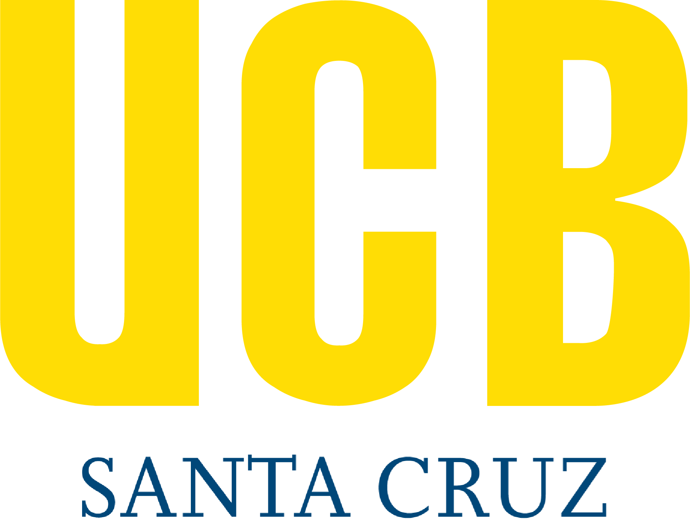

<div align="center">



# UCB Hold

Plataforma full-stack para gestionar reservas, préstamos, mantenimiento y trazabilidad de equipos del Laboratorio de Mecatrónica de la Universidad Católica Boliviana.

<p>
  <a href="#overview">Overview</a>
  ·
  <a href="#architecture">Architecture</a>
  ·
  <a href="#operations">Operations</a>
  ·
  <a href="docs/api.md">API</a>
  ·
  <a href="docs/database.md">Database</a>
  ·
  <a href="CONTRIBUTING.md">Contributing</a>
</p>

[](https://github.com/ucbscz/hold/actions/workflows/tests.yml)
[](https://dotnet.microsoft.com/)
[](https://angular.dev/)
[](https://www.postgresql.org/)
[](https://redis.io/)
[](https://www.docker.com/)

</div>

---

## Overview

UCB Hold centraliza el ciclo operativo de los equipos de laboratorio: consulta de inventario, reservas por disponibilidad, aprobación administrativa, entrega, devolución, contratos, mantenimiento y auditoría. El objetivo del sistema es reducir trabajo manual, evitar conflictos de disponibilidad y conservar trazabilidad clara sobre cada equipo.

### Capabilities

| Domain         | Scope                                                                                                          |
| -------------- | -------------------------------------------------------------------------------------------------------------- |
| Inventory      | Equipment groups, physical units, accessories, components, categories, furniture and lockers.                  |
| Reservations   | Cart-based request flow, date validation, availability checks and loan state transitions.                      |
| Administration | CRUD modules, responsive admin tables, audit views and operational notifications.                              |
| Maintenance    | Preventive and corrective maintenance records by provider and equipment detail.                                |
| Contracts      | HTML contract generation associated with approved loans.                                                       |
| Security       | HttpOnly cookie sessions, rotating refresh tokens, route guards, request validation and private configuration. |

---

## Technology

| Layer          | Stack                                                      | Responsibility                                                           |
| -------------- | ---------------------------------------------------------- | ------------------------------------------------------------------------ |
| Frontend       | Angular 21.2, TypeScript, RxJS                             | Application shell, screens, widgets, forms, guards and HTTP integration. |
| Backend        | ASP.NET Core 8, Ardalis.Result, FluentValidation, Mapperly | REST API, business rules, validation and normalized responses.           |
| Data           | PostgreSQL 16+, EF Core 8, Npgsql                          | Persistence, native enums, triggers, indexes and projections.            |
| Infrastructure | Redis 7, Elasticsearch 8, Hangfire, Docker Compose, Nginx  | Cache, equipment search, background jobs and containerized delivery.     |
| Quality        | NUnit, Jasmine/Karma, GitHub Actions, SonarQube            | Automated tests, coverage, static analysis and CI verification.          |

---

## Architecture

The repository is organized around a small monorepo layout:

```text
.
|-- code/
|   |-- client/      Angular application
|   |-- server/      ASP.NET Core API
|   |-- tests/       Backend automated tests
|   |-- database/    Database bootstrap scripts
|   `-- docker-compose.yml
|-- docs/            Technical documentation and documentation assets
|-- artifacts/       Local/generated artifacts ignored by Git
`-- .github/         CI workflows
```

The frontend follows Feature-Sliced Design with its layers directly under `code/client/src`. Each slice exposes a public `index.ts`; slices import only from lower layers, and entity-to-entity references use the `@x` cross-import API.

| Layer      | Responsibility                                                   |
| ---------- | ---------------------------------------------------------------- |
| `app`      | Bootstrap component, routing, guards and HTTP interceptors.      |
| `pages`    | Routed screens and page-level composition.                       |
| `widgets`  | Reusable application sections such as navigation and sidebars.   |
| `features` | User actions and business flows.                                 |
| `entities` | Domain models, API services and entity-specific UI.              |
| `shared`   | Cross-cutting utilities, directives, primitives and reusable UI. |

Deployment-specific configuration lives beside the layers and contains no logic: `brand` (organization name, labels, colors, fonts and asset paths), `region` (locale and time zone) and `external-services` (identity provider, network provider and blocked image origins).

The backend is a modular monolith. Each business module owns its domain, use cases, persistence and HTTP endpoints, and registers its services through a single `Add<Module>Module` extension:

```text
code/server/src/
|-- Program.cs          Composition root
|-- Bootstrap/          Database, background jobs and startup validation wiring
|-- Modules/
|   |-- Auditoria/      Audit trail
|   |-- Configuracion/  System configuration and schedules
|   |-- Inventario/     Equipment, groups, components, accessories, furniture and lockers
|   |-- Mantenimientos/ Maintenance and maintenance companies
|   |-- Notificaciones/ User notifications
|   |-- Prestamos/      Loans, cart, contracts and availability alerts
|   `-- Usuarios/       Users, careers, authentication and email verification
|       |-- Domain/          Entities and enums
|       |-- Application/     DTOs, mappers, validators and services
|       |-- Infrastructure/  Repositories, EF Core configuration and jobs
|       `-- Api/             Controllers and HTTP security
`-- Shared/             Kernel, persistence, caching, search, email, jobs, security and web building blocks
```

API DTOs do not expose domain entities, credentials, protected identity documents, or stored signatures. Automated boundary tests keep every `Domain` namespace independent from outer layers and keep sensitive mapper defaults closed.

---

## Quick Start

### Docker

Copy the template and replace every placeholder:

```bash
cp code/server.env.example code/server.env
```

`code/server.env` is ignored by Git. `APP_DB_USER` must match the application role created by `code/database/schema.sql`, and `ConnectionStrings__PostgreSQL` must use that role, never the administrator account.

Production Docker requires Data Protection material provisioned at runtime through the team's private operations process. These files are ignored by Git and must never be included in source code, CI artifacts or releases.

Start the stack. The first start applies `code/database/schema.sql` (including Row Level Security) to the empty database volume:

```bash
cd code
docker compose --env-file server.env up --build
```

Enable the application role once the database is healthy, loading the values from `code/server.env`:

```bash
set -a; . code/server.env; set +a
```

```bash
docker exec -i ucb_db psql -U "$POSTGRES_USER" -d "$POSTGRES_DB" -v app_user="$APP_DB_USER" -v app_password="$APP_DB_PASSWORD" <<'SQL'
ALTER ROLE :"app_user" WITH LOGIN PASSWORD :'app_password';
SQL
```

| Service     | URL                   |
| ----------- | --------------------- |
| Frontend    | http://localhost:4200 |
| Backend API | http://localhost:5000 |

### Local Development

```bash
set -a; . code/server.env; set +a
psql -U "$POSTGRES_USER" -d "$POSTGRES_DB" -f code/database/schema.sql
dotnet run --project code/server/UCB_Hold.Server.csproj
```

```bash
cd code/client
npm install
npm start
```

Detailed setup instructions are available in [docs/setup.md](docs/setup.md).

---

## Quality Gates

Run the same checks used by CI before opening a pull request:

```bash
dotnet build code/UCB_Hold.sln
dotnet test code/tests/UCB_Hold.Tests.csproj
```

```bash
cd code/client
npm run format:check
npx tsc -p tsconfig.app.json --noEmit
npx tsc -p tsconfig.spec.json --noEmit
npm run test:coverage
npm run build
```

Generated coverage and quality outputs must stay out of source control. CI publishes reports as workflow artifacts.

---

## Operations

| Concern           | Policy                                                                                                    |
| ----------------- | --------------------------------------------------------------------------------------------------------- |
| Configuration     | Local secrets belong in `code/server.env`, environment variables or `dotnet user-secrets`.                |
| Database schema   | `code/database/schema.sql` documents the database structure maintained by the application.                |
| Database releases | Releases publish source code only; `schema.sql` lives in the repository and backups stay private.         |
| Generated reports | Coverage, SonarQube exports and HTML reports are ignored and uploaded by CI when needed.                  |
| Releases          | Each release publishes source code only; SQL for existing databases goes in the release notes.            |

---

## Documentation

| Document                                 | Purpose                                                               |
| ---------------------------------------- | --------------------------------------------------------------------- |
| [docs/product.md](docs/product.md)       | Audience, problem, core workflows and design principles.              |
| [docs/setup.md](docs/setup.md)           | Local environment, Docker, secrets, verification and troubleshooting. |
| [docs/api.md](docs/api.md)               | REST contracts, response format, endpoints and validation rules.      |
| [docs/database.md](docs/database.md)     | Schema overview, enums, indexes, business rules and restore commands. |
| [CONTRIBUTING.md](CONTRIBUTING.md)       | Branching, commits, pull requests and quality expectations.           |
| [SECURITY.md](SECURITY.md)               | Supported versions, private disclosure and vulnerability handling.    |
| [CODE_OF_CONDUCT.md](CODE_OF_CONDUCT.md) | Professional collaboration standards.                                 |

---

## Maintainers

| Maintainer        | GitHub                                                                  |
| ----------------- | ----------------------------------------------------------------------- |
| Josue Balbontin   | [josue-balbontin](https://github.com/josue-balbontin)                   |
| Alejandro Ramirez | [alejandroramirezvallejos](https://github.com/alejandroramirezvallejos) |
| Fernando Terrazas | [FernandoTerrazasLl](https://github.com/FernandoTerrazasLl)             |
